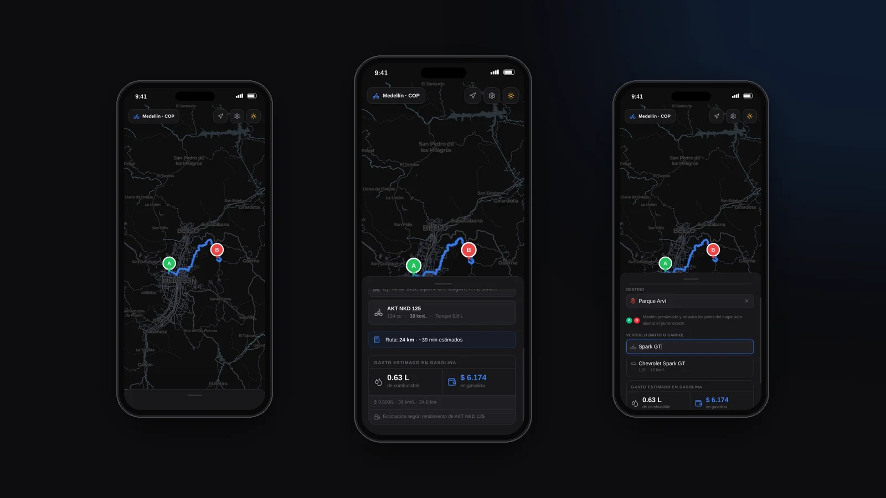

# TripCalc

Calculadora del gasto de gasolina por trayecto, pensada para el celular. Eliges origen y destino en el mapa, el vehículo (moto o carro) y TripCalc calcula la distancia por la ruta real, los litros que vas a gastar y cuánto cuestan en la moneda de tu país.



## Qué hace

- **Rutas reales.** La distancia sale de la ruta por carretera ([OSRM](https://project-osrm.org/)), no de la línea recta.
- **Búsqueda de direcciones.** Geocodificación y geocodificación inversa con [Nominatim](https://nominatim.org/) (OpenStreetMap), con prioridad a la ciudad elegida.
- **Vehículos.** Base local de motos y carros comunes con su consumo (km/L), tanque y autonomía. Si el modelo no está, un LLM (Groq) completa los datos.
- **Moneda local.** Detecta la moneda y el formato según el país (Colombia, México, Argentina, Chile, Perú y más) y propone un precio por litro editable.
- **Mapa** con Leaflet y teselas de CARTO, en modo claro y oscuro.

## Stack

React 19 · TypeScript · Vite · Tailwind CSS 4 · Leaflet / react-leaflet · Firebase Hosting

## Correr en local

```bash
npm install
cp .env.example .env   # llena las claves
npm run dev
```

Variables de `.env`:

| Variable | Para qué |
| --- | --- |
| `VITE_GROQ_API_KEY` | Datos de vehículos que no están en la base local |
| `VITE_GROQ_API_URL` | Endpoint de Groq (ya viene en el ejemplo) |
| `VITE_CARTO_API_KEY` | Teselas del mapa de CARTO |

Otros comandos: `npm run build`, `npm run lint` (Oxlint), `npm run preview`.

## Autor

[Juan Diego Díaz Avendaño](https://juandiegodiaz-dev.web.app) · Desarrollador Full-Stack
